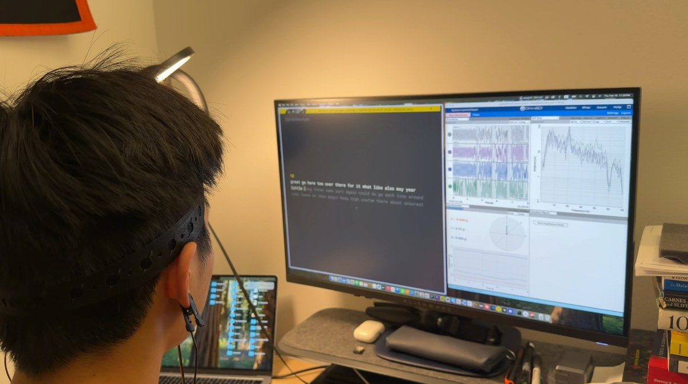

# OpenBCI Ganglion Focus Detection

Real-time focus detection from a 4-channel OpenBCI Ganglion headband. It streams EEG over Lab Streaming Layer, scores each channel continuously, and prints whether your brainwaves look focused, neutral, or distracted compared to your own resting baseline.



I built this to see how much you can actually read off a cheap consumer EEG board.

## How it works

Engagement index is calculated as beta / (theta + alpha). Beta waves rise when you're actively concentrating, whereas theta and alpha rise when you're drowsy or zoned out.

For each channel:

1. Take a 2-second window (400 samples at 200 Hz).
2. Bandpass it into theta, alpha, and beta with a 4th-order Butterworth filter
3. Compute power in each band as the mean squared amplitude.
4. Compute beta / (theta + alpha) and smooth it with an exponential moving average.
5. Z-score it against your baseline and label it.

## Running it

You need the Ganglion streaming over LSL (I used the OpenBCI GUI's networking widget, stream type `EEG`). Format details are in [OpenBCI's networking doc](https://docs.google.com/document/u/1/d/e/2PACX-1vR_4DXPTh1nuiOwWKwIZN3NkGP3kRwpP4Hu6fQmy3jRAOaydOuEI1jket6V4V6PG4yIG15H1N7oFfdV/pub#h.fs64qwm9zn45).

```
pip install numpy scipy pylsl matplotlib pandas
python baseline.py   # sit still, eyes open, ~10 s. writes baseline.json
python run.py        # prints FOCUSED / NEUTRAL / DISTRACTED per channel
```
